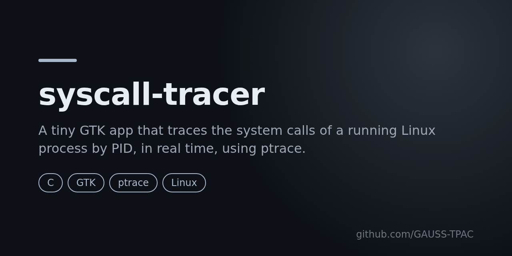

# syscall-tracer



[](LICENSE)
[](https://github.com/GAUSS-TPAC/tracer-appel-System-linux/releases)


A tiny **GTK desktop app** that traces the system calls made by a running Linux process, in real time. Enter a PID, click **Start**, and watch the syscall numbers scroll by. A compact, readable example of how `ptrace` works — useful for learning or teaching operating-system internals.

## How it works

The app attaches to the target process with `PTRACE_ATTACH`, then steps it with `PTRACE_SYSCALL`, reading the syscall number from `orig_rax` at each stop (`PTRACE_GETREGS`). Tracing runs in a background `pthread` so the GTK window stays responsive; **Stop** detaches cleanly.

```
GTK window ──► enter PID ──► pthread ──► ptrace(ATTACH → SYSCALL → GETREGS) ──► syscall numbers
```

## Build & run

Requires GCC, GTK 3 and the pthread library (Linux, x86-64).

```bash
git clone https://github.com/GAUSS-TPAC/tracer-appel-System-linux.git
cd tracer-appel-System-linux
gcc fork.c -o syscall-tracer $(pkg-config --cflags --libs gtk+-3.0) -lpthread
./syscall-tracer
```

Enter the PID of a process you own (e.g. from `pgrep` or `ps`), then click **Start**. You can trace a process started by a different user with `sudo ./syscall-tracer`.

## Notes

- Works on x86-64 (reads `orig_rax`); other architectures use a different register.
- One process can be traced by only one tracer at a time.
- A natural next step: map each syscall number to its name (via `<sys/syscall.h>`) and show the arguments.

## License

[MIT](LICENSE) © GAUSS-TPAC
